# Slipstream

**Email at the speed of thought, for you and your agents.** Slipstream is an open-source, keyboard-first email client. It works with Gmail, Outlook and any IMAP server, keeps your mail in a local database so every keystroke is instant, and runs on your laptop or on your team's own server. Your AI agents get the same powers you have, through MCP, an HTTP API and a CLI. You see everything they do, approve what matters, and undo the rest.

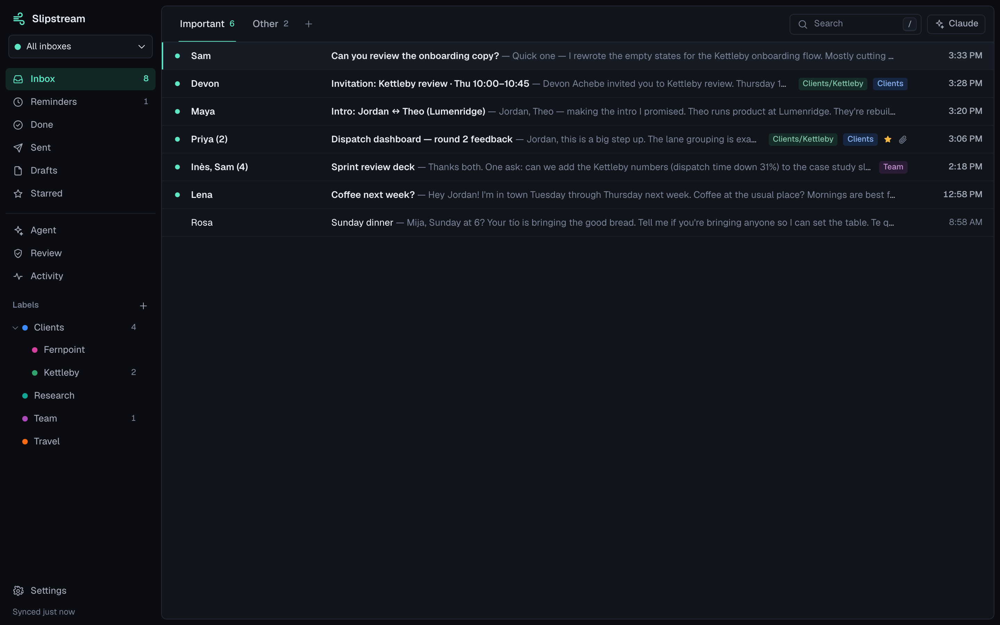

```bash
npx slipstream-mail
```

Slipstream opens at <http://127.0.0.1:4380> with a demo inbox you can fly through before connecting anything. It needs Node.js 22.18 or newer. To keep the `slipstream` command around for the CLI and MCP bridge, install it once with `npm install -g slipstream-mail`.

## Why

Premium "fast email" clients proved that email can feel calm and quick: one key to finish a conversation, reminders that bring mail back when you need it, an inbox you actually clear. They also typically cost $25–40 a seat every month, connect only to Gmail and Microsoft 365, and run your mail through their own servers. Some add read-receipt tracking pixels to the mail you send.

Slipstream keeps the speed and drops the rest.

|  | Slipstream |
|---|---|
| Mail providers | Gmail, Outlook / Microsoft 365, iCloud, Fastmail, Yahoo, Proton Bridge, any IMAP server, plus `.mbox` / `.eml` import |
| Where your mail lives | A SQLite file on your disk (or your team's server) |
| Credentials | Encrypted locally with AES-256-GCM |
| Inboxes | One unified inbox across every account, or one at a time |
| Tracking | None. Remote images are blocked until you choose to see them |
| Shortcuts | Every one remappable |
| AI | Optional. Agents and Autopilot run on your ChatGPT plan, your own Claude Code or Codex, or your key for Claude, OpenAI, Gemini or OpenRouter. Quick summaries use a Claude key |
| Agents | MCP, HTTP API, CLI and webhooks, with scoped tokens, approvals, attribution and undo |
| Price | Free, AGPL-3.0 |

## What it does

- **Triage with one key.** `E` done, `H` remind me, `#` trash, `S` star, `U` unread, `J`/`K` to move, `Z` to undo anything. `Cmd+K` finds every command; `?` shows every shortcut.
- **Split Inbox.** Important (people) and Other (newsletters, notifications) out of the box; add splits for VIPs, a client, a project, anything you can search for.
- **Remind Me.** Type "tomorrow 9am" or "next week". The conversation leaves your inbox and comes back to the top when it's time, or as soon as someone replies.
- **Send Later, Undo Send, follow-up reminders.** Schedule mail, take it back within ten seconds, and get nudged if nobody replies in three days.
- **Snippets with variables.** Type `;` in a draft to insert one; `{first_name}` fills itself in. Share them with your team.
- **Instant Intro.** On an introduction, `Cmd+Shift+I` thanks the introducer and moves them to Bcc.
- **Search that's instant and offline.** Full-text search with `from:`, `to:`, `has:attachment`, `is:unread`, `after:`, `label:` and more, over everything you've synced or imported.
- **Get Me To Zero.** Clear the whole backlog, or everything older than a week or a month, in one undoable step.
- **One-key unsubscribe.** `Cmd+U` unsubscribes and files the newsletter.
- **Labels.** Colors, nesting ("Clients/Kettleby"), and auto-label rules that file new mail as it arrives. Labels you apply sync to Gmail labels, Outlook categories and IMAP keywords; renames and deletes sync to Gmail.
- **Teams.** Shared snippets, shared conversations with comments, assignment and resolve, invite links. Everyone's own mailboxes stay private.
- **AI, if you want it.** One-key summaries and reply suggestions with your own Anthropic key.
- **Agent-native.** Every action is a command your agents can call: over MCP (Claude Code, Claude Desktop, Cursor), over `/api/v1` with an OpenAPI spec, from the `slipstream` CLI, or on webhooks. Agents get scoped tokens. Sending waits in your **Review** queue, and every agent action shows up attributed, with Undo. See [docs/agent-api.md](docs/agent-api.md).
- **Autopilot.** New mail is sorted as it arrives: what needs you stays, receipts and notices are labelled and cleared, later things come back when they matter, and replies are drafted in your voice for you to send. Every decision shows its reason and can be undone, and it learns from what you change. It can't send. See [docs/autopilot.md](docs/autopilot.md).
- **Any model you already have.** Sign in with ChatGPT, use your own Claude Code or Codex, or paste a Claude, OpenAI, Gemini or OpenRouter key. Pick per conversation; every model works through the same commands, approvals and undo. See [docs/models.md](docs/models.md).
- **A cloud agent with one API key.** Paste an Anthropic key and Claude works your inbox on Anthropic's Managed Agents, through Slipstream's own actions. Ask it anything, or give it routines ("weekdays at 8: triage and draft replies", "when client mail arrives: draft a reply"). It has hard budgets per run and per month, and sending still waits for you.
- **claude.ai and ChatGPT, without hosting.** Turn on Tailscale Funnel from Settings and paste the MCP URL into claude.ai or ChatGPT. You approve the connection in Review with a pairing code. Only the MCP endpoint is ever exposed, never your inbox UI.

## See it

| | |
|---|---|
| 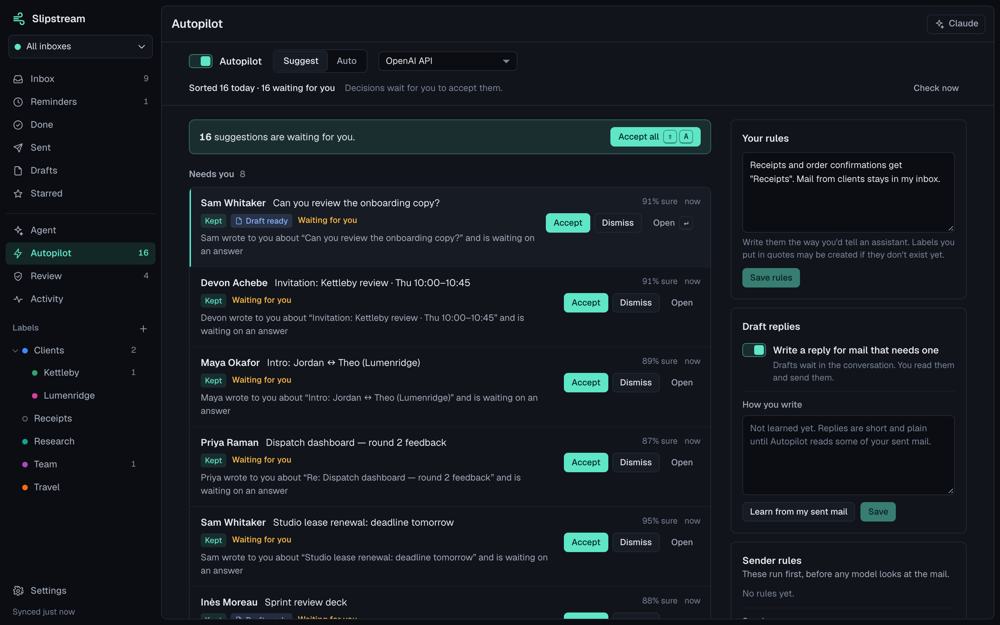 | 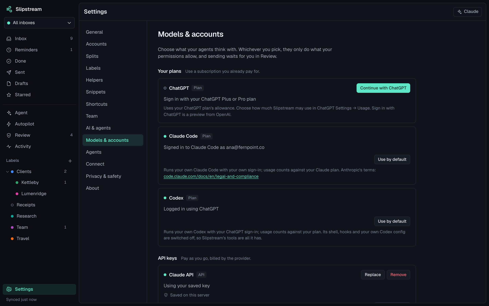 |
| 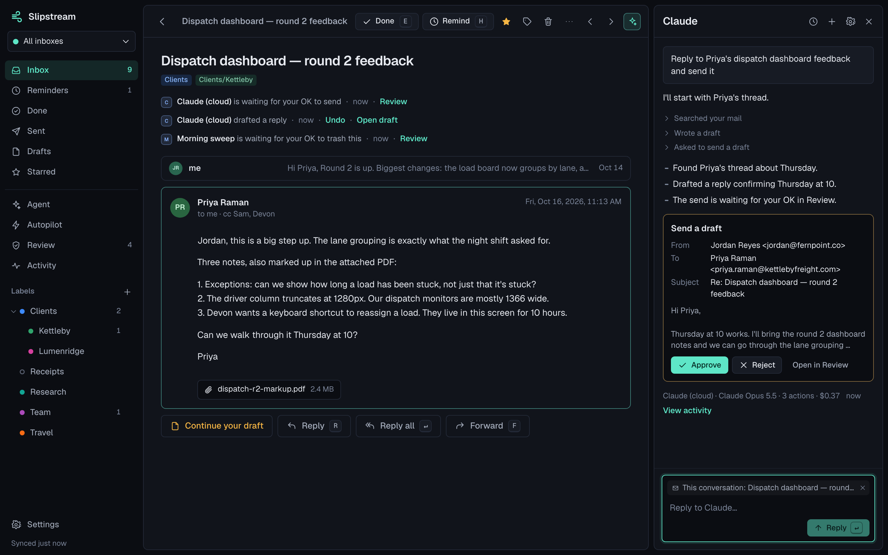 | 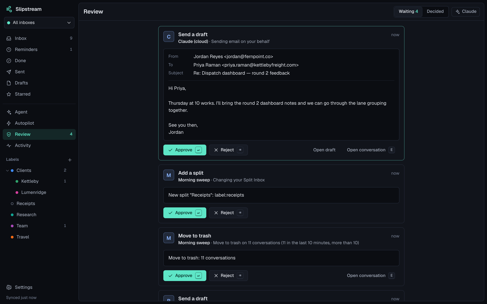 |
| 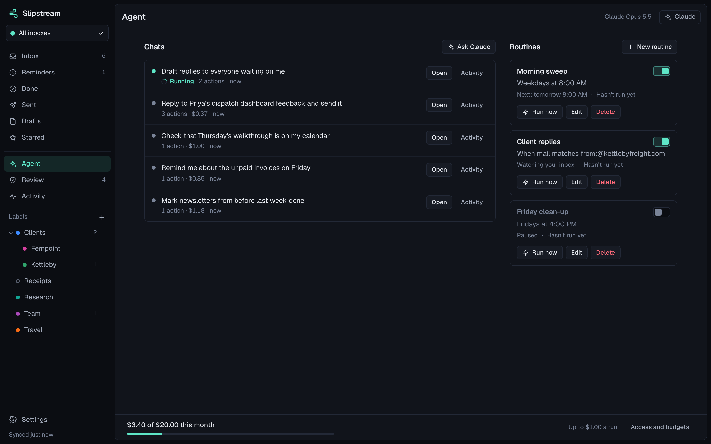 | 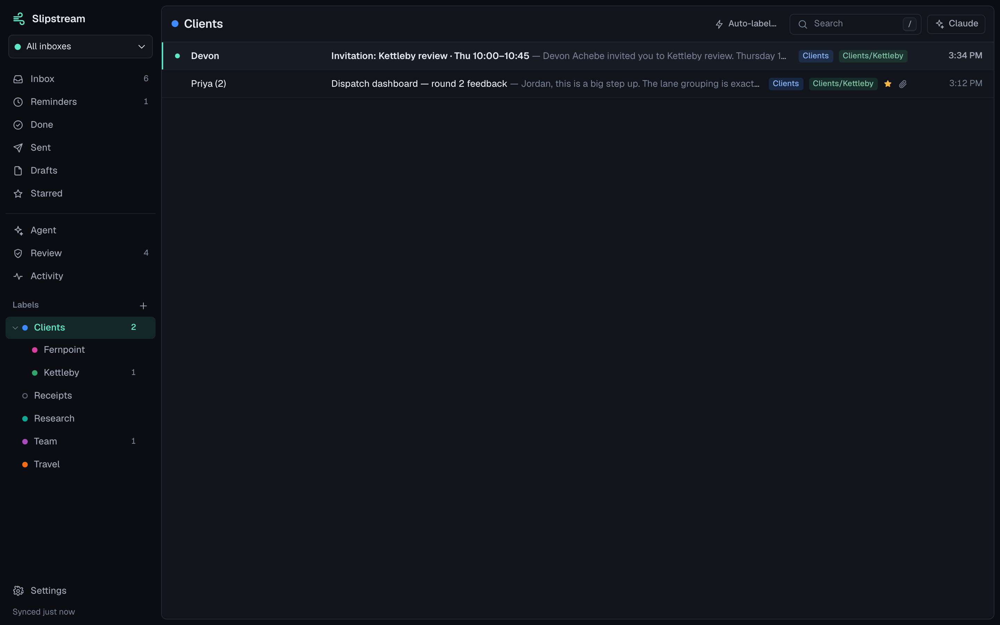 |
| 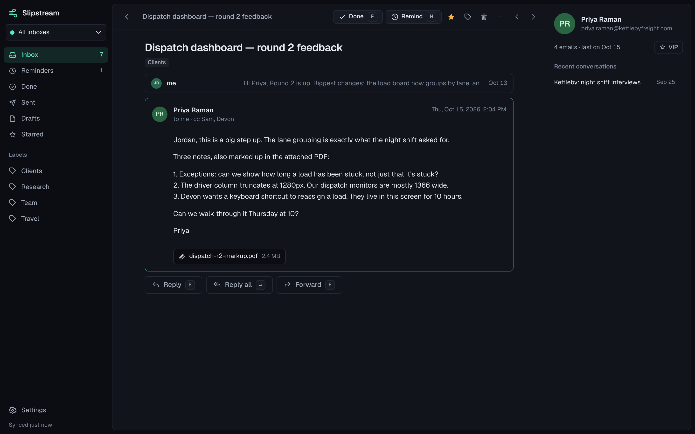 | 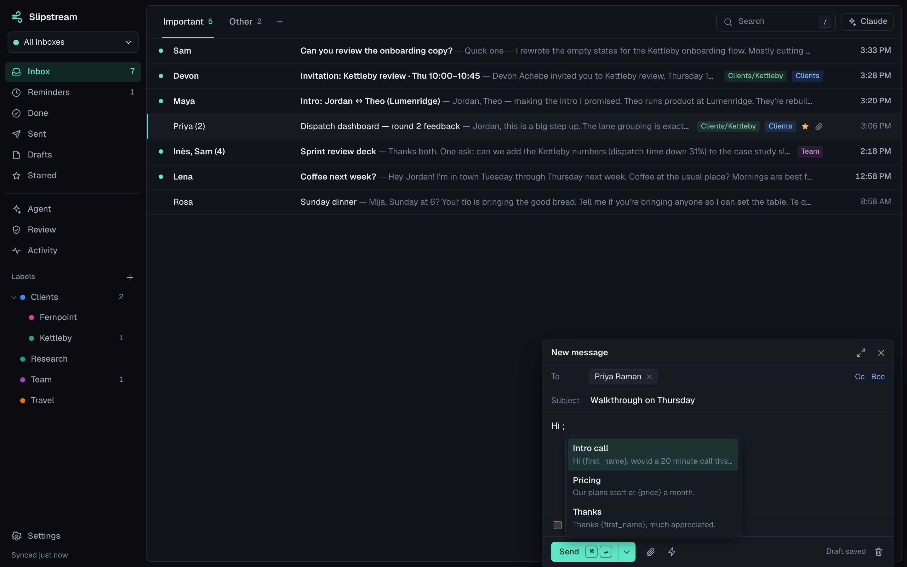 |
| 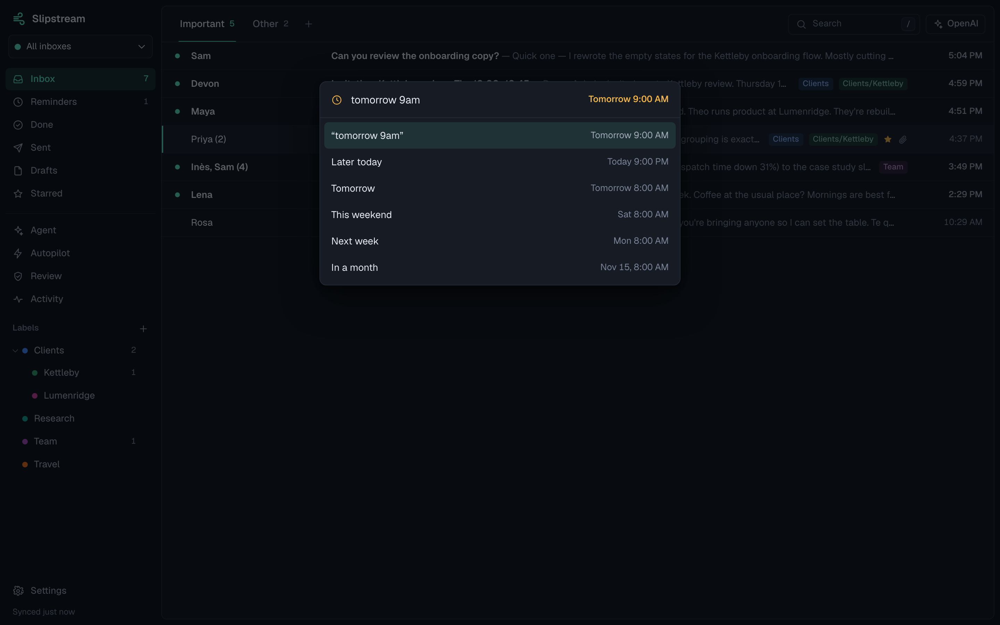 | 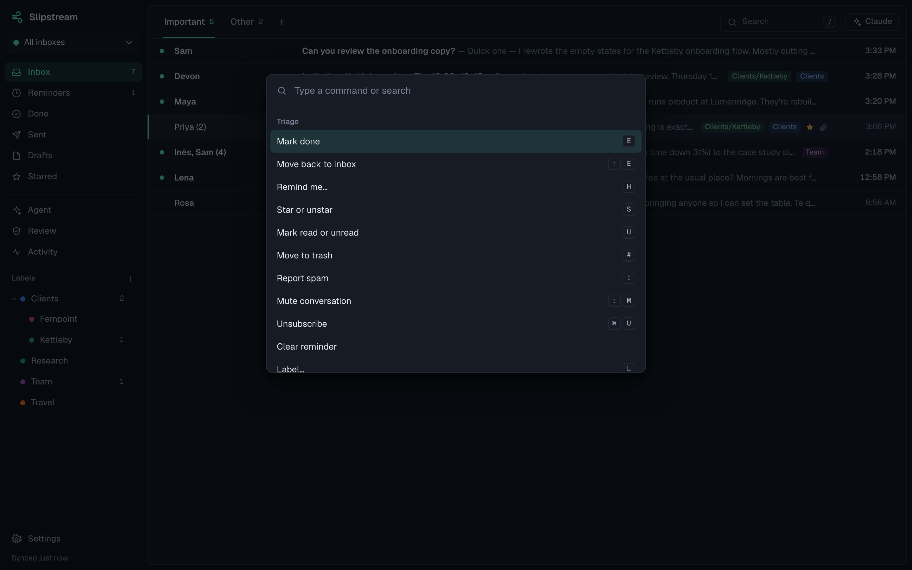 |
| 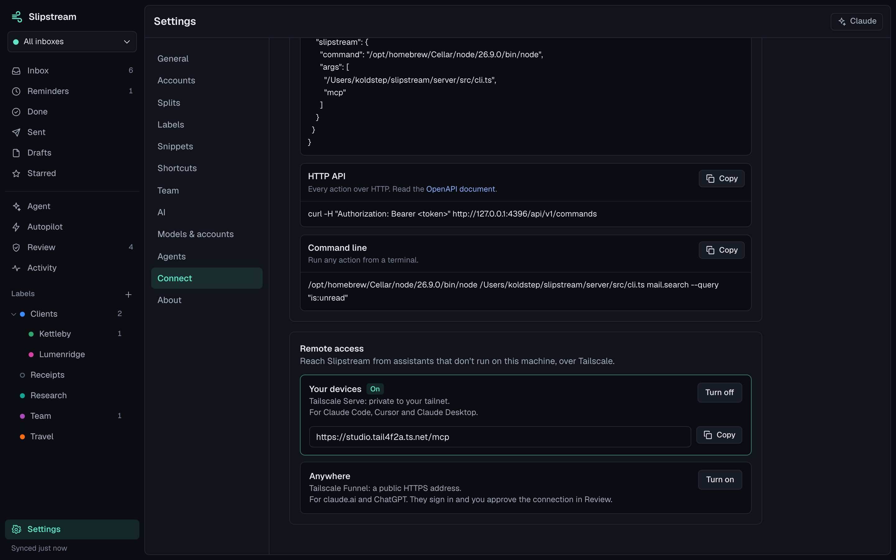 | 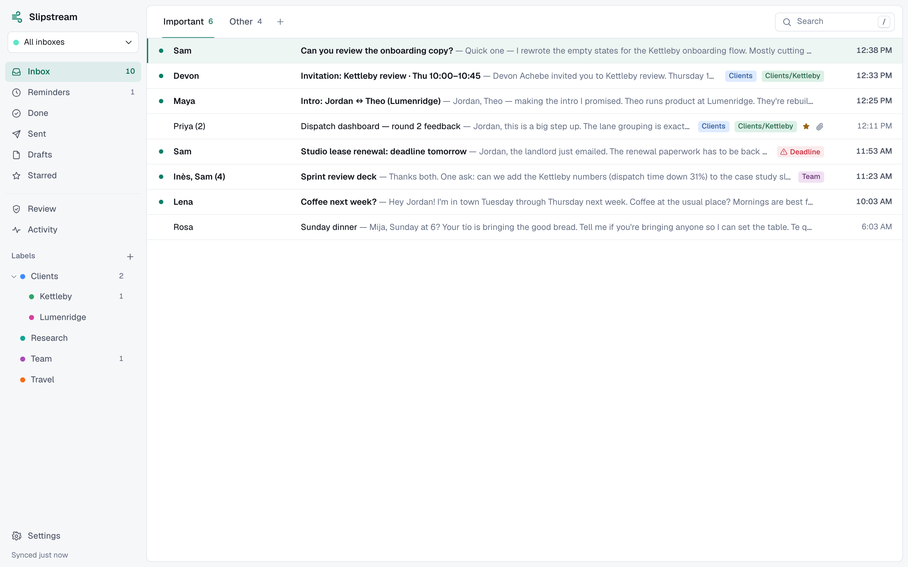 |

## Connect your mail

Settings → Accounts. Gmail works in two minutes with an app password over IMAP; Google and Microsoft OAuth take a one-time setup because each install brings its own OAuth app. Full guide: [docs/connect-accounts.md](docs/connect-accounts.md).

## Run it for a team

```bash
fly launch --no-deploy --copy-config
fly volumes create slipstream_data --size 3
fly secrets set SLIPSTREAM_SECRET="$(openssl rand -base64 32)"
fly deploy
```

Fly.io is the recommended host: one always-on machine with a volume, about $4 a month at October 2026 prices. Docker Compose works on any server; Render and Railway configs are included. Continuous backups go to any S3-compatible bucket with Litestream. See [docs/self-hosting.md](docs/self-hosting.md).

## Fast, measured

50,000 messages (16,667 conversations) in a local store, Apple Silicon laptop, `npm run bench`:

| Operation | p50 | p95 |
|---|---|---|
| Open a split (first 100 conversations) | 0.9 ms | 1.2 ms |
| Unread counts for every split | 6.9 ms | 8.1 ms |
| Full-text search, typical two-word query | 4.8 ms | 5.1 ms |
| Full-text search, worst case (a word in nearly every message) | 53 ms | 56 ms |
| Mark done and undo it (two writes) | 0.2 ms | 0.3 ms |
| Open a conversation | 0.05 ms | 0.08 ms |
| Agent: search over HTTP (`/api/v1/mail.search`, with auth) | 3.7 ms | 4.2 ms |
| Agent: search over MCP (`tools/call mail_search`) | 3.9 ms | 4.5 ms |
| Agent: whole-inbox digest in one call (`mail.digest`) | 9.8 ms | 12.2 ms |

Provider round-trips never block you: actions apply locally first and reach Gmail, Outlook or your IMAP server a few seconds later, after the undo window.

## Develop

```bash
git clone https://github.com/Tradelord223/slipstream && cd slipstream
npm install
npm run dev        # server on :4392 with a demo inbox + web app on :5180
npm test           # server tests (node:test)
npm run test:contract   # black-box API + MCP contract suite against a live server
npm run test:render     # shows hostile email in headless Chrome and proves nothing runs or leaks (needs Chrome; see docs/security.md)
npm run typecheck
npm run build && npm start
```

The server is TypeScript run directly by Node (no build step in development), Hono for HTTP, `node:sqlite` with FTS5 for storage. The web app is React + Vite with plain CSS. The server has no native npm dependencies (SQLite comes with Node). More in [docs/architecture.md](docs/architecture.md); agents, MCP and remote access in [docs/agent-api.md](docs/agent-api.md); the security model is in [docs/security.md](docs/security.md); how the product was reverse-engineered (clean-room, from public material) is in [docs/reverse-engineering.md](docs/reverse-engineering.md).

## License

Slipstream is licensed under the [GNU AGPL v3.0](LICENSE). Use it, run it for your company, change it. If you run a modified Slipstream for other people over a network, the AGPL asks you to offer them its source; set `SLIPSTREAM_SOURCE_URL` so the app's source link points at your version. Bundled third-party software and fonts keep their own licenses, listed in `THIRD_PARTY_LICENSES.txt` in every build.
